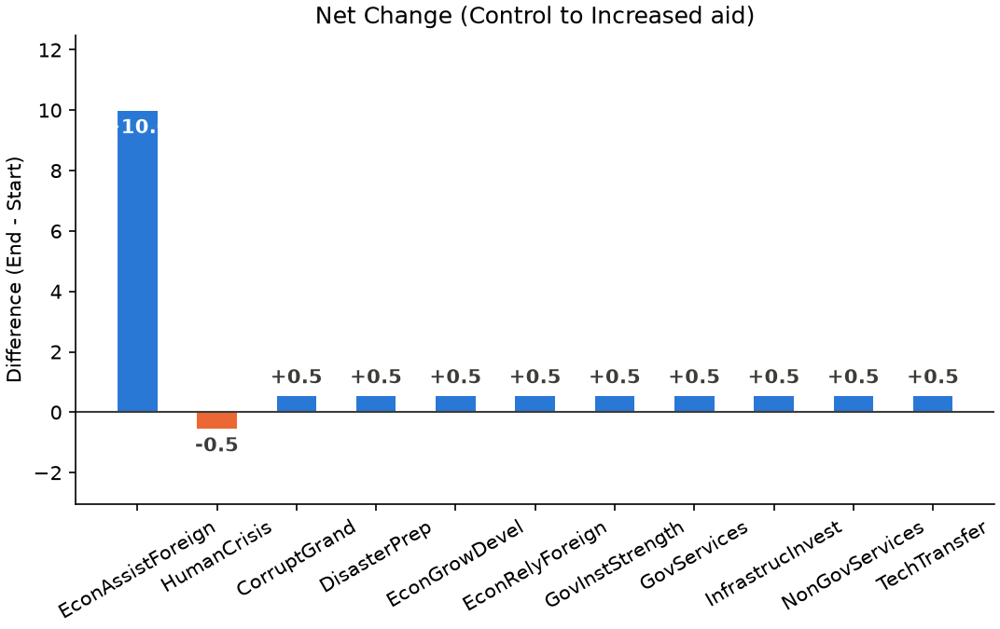

# AECM Fuzzy Cognitive Mapping

A Python toolkit for building and running **Actor–Environment Conceptual Model
(AECM)** scenarios with a **Fuzzy Systems Dynamics Model (FSDM)** solver. It
loads AECM topology from Excel or FSDM-compatible JSON, applies interventions
over multiple increments, reports convergence diagnostics, and supports
sensitivity and Monte Carlo analysis.

The repository includes a worked foreign-economic-assistance scenario that
shows how to compare an intervention with a matched control, inspect adverse
effects, and test a safeguard assumption.



## Features

- Validate AECM node definitions, edge lists, and adjacency matrices.
- Build full, incident-link, or induced-subgraph models.
- Run linear or exponential intervention schedules.
- Return long-form trajectories, convergence diagnostics, and ranked changes.
- Sample uncertain edge weights with reproducible Monte Carlo runs.
- Plot final-minus-baseline changes as a PNG.
- Run FSDM JSON model/scenario directories from the command line.

## Requirements

- Python 3.10 or newer
- NumPy
- pandas
- openpyxl (for AECM Excel workbooks)
- Matplotlib (for charts)

Create an environment and install the recorded dependencies:

```bash
python -m venv .venv
source .venv/bin/activate
python -m pip install --upgrade pip
python -m pip install -r requirements.txt
```

For solver-only use, a smaller installation is sufficient:

```bash
python -m pip install numpy pandas openpyxl matplotlib
```

> [!NOTE]
> AECM Excel workbooks are intentionally excluded from version control. Supply
> your own workbook when using `load_aecm`; FSDM JSON scenarios do not require
> Excel.

## Quick start

### Use an AECM workbook

`load_aecm` expects these worksheets:

- `AECM 2.0 Node Definitions`
- `AECM 2.0 Edgelist`
- `AECM 2.0 Adjacency Matrix`

The loader verifies that the edge list and adjacency matrix agree before
returning node metadata and a signed source-by-target matrix.

```python
import fsdm

nodes, signs = fsdm.load_aecm("AECM 2.0 Model.xlsx")

# Magnitudes are an analytical assumption; the workbook supplies polarity.
model = fsdm.build_aecm_model(
    signs * 0.05,
    nodes=nodes,
    anchors=["EconAssistForeign"],
    selection="incident",
)

baseline = dict.fromkeys(model.concepts.index, 0.50)
scenario = fsdm.build_fsdm_scenario(
    model,
    baseline,
    targets={"EconAssistForeign": 0.60},
    increments=10,
)

trajectory, diagnostics, summary = fsdm.run_fsdm_scenario(scenario)

if not diagnostics["converged"].all():
    raise RuntimeError("One or more increments did not converge")

print(summary.head(10))
```

`trajectory` contains every concept at increment zero and at each subsequent
increment. `diagnostics` records iterations, convergence, and maximum relative
change. `summary` ranks concepts by absolute net change.

### Run an FSDM JSON scenario

An FSDM model uses `concepts.json` and `relations.json`. A scenario uses
`scenario.json` and `increments.json`; the four files may be colocated, or the
scenario may use the standard layout below:

```text
models/AECM/
├── concepts.json
├── relations.json
└── scenarios/
    └── IncreasePeace/
        ├── scenario.json
        └── increments.json
```

Run validation, simulation, and summarization from the command line:

```bash
python fsdm.py models/AECM/scenarios/IncreasePeace --output-dir results
```

For a nonstandard layout, identify the model explicitly:

```bash
python fsdm.py path/to/scenario \
  --model-dir path/to/model \
  --mode exponential \
  --weight-scale 0.5 \
  --output-dir results
```

The output directory contains:

| File | Contents |
| --- | --- |
| `trajectory.csv` | Per-concept values at every increment, in declared and internal units |
| `diagnostics.csv` | Per-increment iteration and convergence information |
| `summary.csv` | Initial value, final value, net change, and percent change |

Use `python fsdm.py --help` for all CLI options.

## Sensitivity analysis

Sample one or more signed edge weights from independent uniform ranges. Each
intervention draw is compared with a matched no-intervention control:

```python
sampled_weights, status, changes = fsdm.run_fsdm_monte_carlo(
    scenario,
    {
        ("EconAssistForeign", "CorruptGrand"): (0.00, 0.05),
        ("EconAssistForeign", "HumanCrisis"): (-0.075, -0.025),
    },
    draws=200,
    seed=42,
)

converged = status["converged"].sum()
percentiles = changes.groupby("node_id")["change"].quantile([0.05, 0.50, 0.95])
print(f"Converged draws: {converged}/{len(status)}")
print(percentiles)
```

Only converged intervention/control pairs appear in `changes`. Always report
the successful count alongside percentiles.

## Plotting results

`plot_net_change` subtracts the first column from the last and saves a PNG:

```python
from plot_net_change import plot_net_change

comparison = summary.set_index("node_id")[["start_value", "final_value"]]
plot_net_change(comparison, "net_change.png")
```

## Model semantics

- Matrix rows are **sources** and columns are **targets**.
- Edge weights must be finite values in `[-1, 1]`; zero means no edge.
- The solver operates strictly inside `(0, 100)` and raises an error rather
  than clipping values that leave the domain.
- A target is applied incrementally and may receive feedback from the network,
  so its final value can differ from the requested target.
- Increment zero is the baseline.
- The default convergence tolerance is a `0.01%` relative change.
- Positive score movement is not automatically beneficial; interpretation
  depends on the meaning of each concept.

Relationship magnitudes, baselines, targets, and uncertainty ranges are model
assumptions. Preserve them with reported results and check every convergence
diagnostic before drawing conclusions.

## Worked example and documentation

- [`foreign-aid-analysis.md`](foreign-aid-analysis.md) — complete deterministic,
  sweep, Monte Carlo, and safeguard walkthrough.
- [`aecm-foreign-aid-notes.ipynb`](aecm-foreign-aid-notes.ipynb) — executable
  analysis notebook.
- [`FSDM.md`](FSDM.md) — solver details, JSON workflow, and Foundry integration.
- [`aecm-planner-engineering-handoff.md`](aecm-planner-engineering-handoff.md) —
  requirements and acceptance fixtures for a planner application.
- [`aecm-fsdm.R`](aecm-fsdm.R) — original R workflow used as a reference.

## Repository layout

```text
fsdm.py                          Core model loading, simulation, and analysis
plot_net_change.py               Net-change chart helper
foreign-aid-analysis.md          Reproducible worked scenario
aecm-foreign-aid-notes.ipynb     Notebook version of the analysis
aecm-planner-engineering-handoff.md
                                 Application design and acceptance criteria
FSDM.md                          Extended technical documentation
FSDM-LICENSE                     Apache 2.0 license for the FSDM-derived work
FSDM-NOTICE                      Attribution and adaptation notice
```

## Attribution and license

The solver is based on Brian Gregor's
[FSDM](https://github.com/gregorbj/FSDM) R implementation. The Python version
adapts its simulation equations and adds AECM workbook ingestion, validation,
and tabular outputs. See [`FSDM-NOTICE`](FSDM-NOTICE) for attribution and
[`FSDM-LICENSE`](FSDM-LICENSE) for the Apache License 2.0 terms applicable to
the FSDM-derived work.
